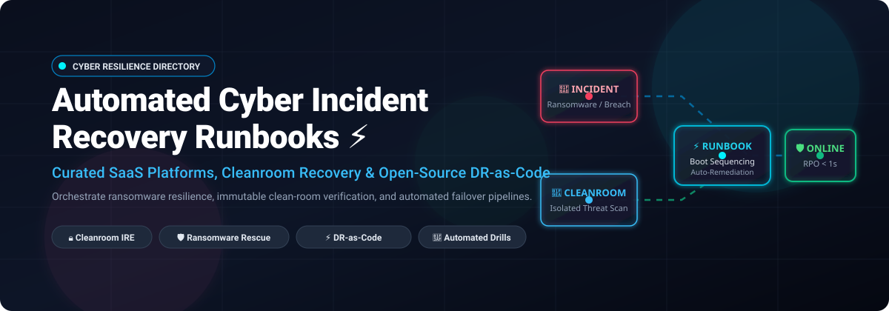

# 🛡️ Awesome Automated Cyber Incident Recovery Runbooks ⚡

  

  
  
  
  
  
  
  

---

## 🚀 Overview & Ecosystem Summary

> **Curated ecosystem directory of Enterprise SaaS platforms, Isolated Recovery Environments (IRE), Cleanroom orchestration runbooks, and Open-Source Disaster-Recovery-as-Code (DR-as-Code) solutions.**  
> *Targeted for Site Reliability Engineers (SREs), SecOps teams, Cyber Incident Handlers, and Enterprise Resilience Architects.*

This repository tracks notable **SaaS platforms** and **open-source projects** for **Automated Cyber Incident Recovery Runbooks**. In an era dominated by sophisticated ransomware, state-sponsored intrusion vectors, and software supply chain attacks, traditional offline backups are no longer sufficient. Modern cyber incident response demands **automated cleanroom validation**, **boot-order sequencing**, **IOC / telemetry threat scanning**, **immutable point-in-time snapshots**, and **post-recovery automated verification scripts** to ensure systems are safely brought back online without re-infecting production environments.

---

## 📑 Table of Contents
- [📊 Sector Overview & Market Dynamics](#-sector-overview--market-dynamics)
- [☁️ Enterprise SaaS & Hosted Platforms](#️-enterprise-saas--hosted-platforms)
- [🔓 Open-Source GitHub Projects](#-open-source-github-projects)
- [🤝 How to Contribute](#-how-to-contribute)
- [💖 Support & Sponsoring](#-support--sponsoring)
- [📈 Star History](#-star-history)
- [⚖️ Disclaimer](#️-disclaimer)

---

## 📊 Sector Overview & Market Dynamics

The global **Cyber Recovery and Disaster Recovery as a Service (DRaaS)** market is valued between **$13 billion and $17 billion** and is projected to expand at an annual growth rate (CAGR) of **16% to 23%** into the next decade. 

The sector displays a bifurcated market structure:
1. **Underlying Infrastructure Layer (Highly Concentrated):** Heavily dominated by hyperscalers (Microsoft Azure, AWS, and Google Cloud) providing the core storage tiers, compute capacity, and recovery target endpoints.
2. **Software & Cyber-Recovery Orchestration Layer (Moderately Fragmented):** Composed of specialized enterprise software vendors, agile backup innovators, and open-source tooling competing aggressively on rapid recovery point objectives (RPO < 1s), automated cleanroom quarantine testing, threat-hunting telemetry, and cross-cloud mobility.

---

## ☁️ Enterprise SaaS & Hosted Platforms

| 🏢 Company / Platform | 💼 Company Size (Valuation / Revenue) | 💵 Starting Price (Specific Tier) | 🎁 Free Tier Limits / Free Trial Policy | 🛡️ Key Cyber Recovery Runbook Capabilities |
| :--- | :--- | :--- | :--- | :--- |
| **[Azure Site Recovery](https://azure.microsoft.com/en-us/products/site-recovery)** | **$3.1T+ Market Cap** / $245B+ Annual Revenue (Microsoft) | **$25.00/instance/month** (replicated to Azure) or **$16.00/instance/month** (replicated to customer-owned sites) | **31-Day Free Trial per instance** (first 31 days free for every protected instance; compute/storage consumed during drills billed separately) | Ordered VM groups, native Azure Automation runbook orchestration, scripted post-failover validation for multi-tier apps [citation:9][citation:18]. |
| **[AWS Elastic Disaster Recovery](https://aws.amazon.com/disaster-recovery/)** | **$2.1T+ Market Cap** / $600B+ Annual Revenue (Amazon / AWS) | **$0.028/server/hour** (~$20.44/server/month base software license) | **No permanent free tier**; introductory AWS free trial promotions provide up to 90 days per server for eligible new accounts (EBS/EC2 drill infrastructure billed separately) | Continuous block-level replication, sub-second RPO point-in-time recovery, automated non-disruptive recovery drills, cross-Region failover [citation:8]. |
| **[CloudEndure Disaster Recovery (AWS)](https://docs.cloudendure.com/)** | **$2.1T+ Market Cap** / $600B+ Annual Revenue (Amazon / AWS) | **$0.028/server/hour** (~$20.44/server/month base software license) | **No permanent free tier**; trial evaluation accessible via AWS account setup (replicated staging compute/EBS storage billed separately) | Continuous block-level replication and automated recovery orchestration for physical, virtual, and cloud workloads [citation:7]. |
| **[IBM Cyber Resiliency (Safeguarded Copy)](https://www.ibm.com/)** | **$210B+ Market Cap** / $62B+ Annual Revenue (IBM) | **Included with IBM Storage Virtualize base license**; advanced IBM Storage Defender software suite starts at ~$65.00/TB/year | **No permanent free tier**; offers structured **14-day on-premises proof-of-concept (PoC) / test-drive** program and free cyber resilience assessment | Immutable Safeguarded Copy snapshots, air-gapped copies, cryptographic verification, and surgical isolated recovery for z/OS and distributed storage [citation:10]. |
| **[HPE Zerto Cyber Recovery Plans](https://www.zerto.com/)** | **$25B+ Market Cap** / $29B+ Annual Revenue (Hewlett Packard Enterprise) | **$33.00/VM/month** (cloud migration tier) to **$83.33/VM/month** ($1,000/VM/year enterprise baseline) | **30-Day Free Trial** up to 10 VMs via Zerto In-Cloud (or 14-day trial for up to 15 VMs on enterprise packages) | Platform-native cyber recovery plans, ordered multi-VPG orchestration, journaling to recover to clean points pre-dating compromise [citation:2]. |
| **[Veeam Disaster Recovery Orchestrator](https://www.veeam.com/)** | **$15B Valuation** / $1.7B+ ARR (Veeam Software) | **$12.92/workload/month** ($155/workload/year under Veeam Universal License packs) | **Free forever plan: Community Edition up to 10 workloads**; full enterprise orchestration trial available for **30 days** | Automated recovery plan orchestration, isolated test labs (DataLabs), compliance-ready dynamic DR documentation, malware scanning [citation:3][citation:15]. |
| **[Rubrik Cyber Recovery](https://www.rubrik.com/)** | **$13.9B Market Cap** / $1.09B Subscription ARR (Rubrik, Inc.) | **$130.00/TB/month** (Backup Enterprise Terabyte list baseline; multi-year enterprise contracts start at ~$50,000/year) | **No permanent free tier**; structured **30-day Proof-of-Concept (PoC) / trial** available through enterprise sales team | Cleanroom Live Mount threat hunting, anomaly-filtered snapshot selection, boot-order sequencing, automated quarantine [citation:4]. |
| **[Cohesity SiteContinuity](https://www.cohesity.com/)** | **$7B–$8B Valuation** / $1.7B+ Combined Revenue (Cohesity) | **$83.33/TB/month** ($1,000/TB/year baseline enterprise commitment; AWS Marketplace starts at $2,425/month for 10 BETB) | **30-Day Free Trial** for Cohesity DataProtect / BaaS cloud orchestration (underlying cloud infrastructure costs apply) | Unified backup and automated DR, policy-driven failover/failback orchestration, isolated recovery testing across hybrid clouds [citation:5]. |
| **[Commvault Cleanroom Recovery](https://documentation.commvault.com/)** | **$5.5B–$6.6B Market Cap** / $996M Annual Revenue (Commvault) | **$8.17/VM/month** ($98/VM/year hybrid VM pack) or **$58.50/TB/month** for SaaS cloud storage; Cleanroom capacity starts in 10 TB recovery blocks | **30-Day Free Trial** (no credit card required) for Commvault Cloud SaaS and Cleanroom Recovery testing | AWS cleanroom automated provisioning, integrated Microsoft Defender scanning, custom validation scripts, prioritized VM boot sequencing [citation:6]. |
| **[Druva Cyber Recovery Runbooks](https://www.druva.com/)** | **$2B Peak Valuation** / $200M+ SaaS ARR (Druva) | **$8.00/user/month** (SaaS/endpoint tier) or **$200.00/credit/month** (1 credit = 1 TB deduplicated storage/month) | **30-Day Free Trial** (extendable up to 60 days via tenant admin) with full access to SaaS resiliency workflows | Automated Scheduled Cyber Recovery Testing, Live Incident Recovery orchestration, Isolated Recovery Environment (IRE) and IOC scanning [citation:1][citation:13]. |

---

## 🔓 Open-Source GitHub Projects

Curated open-source recovery orchestrators, bare-metal disaster recovery engines, ransomware decryption tools, and automated incident response runbooks. Sorted in descending order by GitHub_Stars.

1. **[BorgBackup](https://github.com/borgbackup/borg)**   
   ⚡ Deduplicating, authenticated, and encrypted backup framework ideal for automated recovery pipelines and immutable storage backends.

2. **[Velero](https://github.com/vmware-tanzu/velero)**   
   ⚡ Cloud-native disaster recovery and migration platform for Kubernetes clusters, automating persistent volume snapshots and cluster state recovery.

3. **[OpenCTI](https://github.com/opencti-platform/opencti)**   
   ⚡ Open-source cyber threat intelligence platform used to feed IOCs into automated recovery cleanrooms and validation runbooks.

4. **[Chaos Mesh](https://github.com/chaos-mesh/chaos-mesh)**   
   ⚡ Cloud-native chaos engineering platform for simulating catastrophic outages, infrastructure failure injection, and validating automated recovery runbooks.

5. **[CALDERA (MITRE)](https://github.com/mitre/caldera)**   
   ⚡ Scalable automated adversary emulation platform built on the MITRE ATT&CK framework to continuously test and trigger cyber recovery mechanisms.

6. **[LitmusChaos](https://github.com/litmuschaos/litmus)**   
   ⚡ Cloud-native chaos engineering orchestration framework designed to automate recovery drill scenarios and verify resilience SLAs.

7. **[GRR Rapid Response](https://github.com/google/grr)**   
   ⚡ Google's remote live forensics and triage framework for enterprise-scale incident response and post-compromise system remediation.

8. **[TheHive](https://github.com/TheHive-Project/TheHive)**   
   ⚡ Security Incident Response Platform (SIRP) offering structured case management, task assignment, and integration with execution runbooks.

9. **[FIR (Fast Incident Response)](https://github.com/certsocietegenerale/FIR)**   
   ⚡ Cybersecurity incident management platform created by CERT Société Générale to track response and recovery workflows efficiently.

10. **[Cortex](https://github.com/TheHive-Project/Cortex)**   
    ⚡ Powerful observable analysis and active response engine providing automated execution of remediation and quarantine runbooks.

11. **[Demisto Content (Cortex XSOAR)](https://github.com/demisto/content)**   
    ⚡ Broad repository of automation playbooks, integrations, and incident recovery scripts for security orchestration and response.

12. **[Bareos](https://github.com/bareos/bareos)**   
    ⚡ Cross-network open-source backup and disaster recovery solution with scripting hooks for automated failover and verification.

13. **[Relax-and-Recover (ReaR)](https://github.com/rear/rear)**   
    ⚡ Leading bare-metal disaster recovery and system migration solution for Linux, generating automated bootable rescue images [citation:16].

14. **[c3rb3r-rescue](https://github.com/soimy/c3rb3r-rescue)**   
    ⚡ Evidence-preserving ransomware recovery suite for Synology DSM systems, featuring RAM key extraction and Btrfs copy-on-write recovery routes.

15. **[lockbit-rescue](https://github.com/Saddytech/lockbit-rescue)**   
    ⚡ Recovery toolkit exploiting Salsa20 keystream reuse vulnerabilities across file batches to decrypt LockBit 3.0 ransomware targets [citation:19].

16. **[c3rb3r-btrfs-recovery](https://github.com/crt106/c3rb3r-btrfs-recovery)**   
    ⚡ Keyless recovery mechanism for C3RB3R-encrypted Synology/Btrfs file systems by remapping modified blocks back to preserved storage extents [citation:29].

17. **[Stronghold](https://github.com/mehdi-arfaoui/Stronghold)**   
    ⚡ DRP-as-Code platform that generates dependency graphs, identifies single points of failure, builds automated runbooks, and micro-tests recoveries [citation:12].

18. **[0xelitesystem/incident-response-runbooks](https://github.com/0xelitesystem/incident-response-runbooks)**   
    ⚡ Ten comprehensive incident response runbooks spanning ransomware, API key compromise, data exfiltration, and supply chain containment [citation:11].

19. **[multicloud-disaster-recovery](https://github.com/bukx/multicloud-disaster-recovery)**   
    ⚡ Multi-cloud disaster recovery architecture across AWS, Azure, and GCP utilizing Terraform, Pulumi, Ansible, and automated failover routing [citation:27].

20. **[cloud-dr-orchestrator](https://github.com/Kobeep/cloud-dr-orchestrator)**   
    ⚡ Multi-cloud disaster recovery orchestrator automating backup schedules, client encryption, and restore workflows on Oracle Cloud Free Tier [citation:17].

21. **[DaliBackup-OSS](https://github.com/daliranas/DaliBackup-OSS)**   
    ⚡ Sovereign, lightweight backup engine and disaster recovery orchestrator for Hyper-V and Proxmox VE with embedded AES-256-GCM encryption [citation:21].

---

## 🤝 How to Contribute

Contributions are warmly welcomed! Help keep this cyber resilience directory fresh and accurate:

1. **Fork** the repository 🍴
2. **Add or refine entries** following the established format (ensure exact pricing models and free trial specifications are provided for SaaS entries, and official GitHub links for OSS).
3. **Submit a Pull Request** with a concise description of your additions.

⭐ Don't forget to **star** this repository to keep it visible to fellow security and infrastructure engineers!

---

## 💖 Support & Sponsoring

If you find this curated collection useful for your enterprise security architecture, incident response drills, or disaster recovery planning, please consider supporting the project:

- ⭐ **Star** and **Fork** this repository to spread awareness across the SecOps community!
- 📢 **Share** with your platform engineering, SRE, and cybersecurity teams.
- ☕ **Buy me a coffee / Sponsor**: Support continuous research and maintenance via the [GitHub Sponsors Dashboard](https://github.com/sponsors/ishandutta2007).

---

## 📈 Star History

---

## ⚖️ Disclaimer

- This is a community-curated list intended for research, architectural planning, and educational purposes.
- All recovery runbooks, cleanroom scripts, and disaster recovery strategies must be validated in an isolated staging environment against your organization's specific Recovery Time Objectives (RTO) and Recovery Point Objectives (RPO).
- Self-hosted open-source software and decryption scripts must be verified for safe execution within strict sandbox boundaries.

---

  <b>Built for SREs, SecOps engineers, incident responders, and resilience architects worldwide. 🛡️⚡</b>

